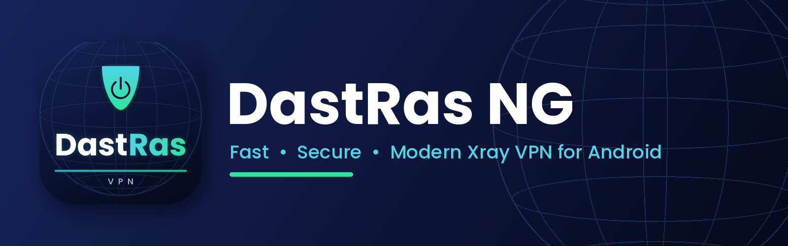

**A fast, modern, Xray-powered VPN client for Android**
 
**یک کلاینت سریع، مدرن و مبتنی بر هسته‌ی Xray برای اندروید**

 

**[English](#-english) · [فارسی](#-فارسی)**

---

## 🇬🇧 English

### ✨ Highlights

| | |
|---|---|
| ⚡ **High speed** | Tuned for throughput: QUIC blocking, MTU control, lightweight routing and no extra overhead |
| 🇮🇷 **Bypasses Iranian IPs and sites** | Iranian websites and IPs go direct, everything else goes through the VPN |
| 🚀 **Smart auto-connect** | Tests every server (latency and stability) before connecting and picks the best one |
| 🔁 **Seamless server switch** | Tap another server while connected and it reconnects by itself |
| 📊 **Live speed** | Real-time download / upload, session usage, graph and a live notification with a *Disconnect* button |
| 🧩 **Per-app proxy** | Send only the apps you choose through the VPN, or everything except them. Chosen apps are shown first |
| 🔗 **Subscriptions** | Links and JSON subscriptions, auto-refresh, usage bar, copy / share the link |
| 📷 **QR codes** | Scan a QR with the camera to add a subscription or config, and show a QR of your links |
| ⏰ **Account alerts** | Warns when data is almost gone or the account is about to expire, with one tap to message support on Telegram |
| 🔄 **In-app updates** | Reads new releases from GitHub, tells you in the inbox, shows the changelog and installs the update |
| 🎨 **Modern design** | Light / dark / system themes, floating glass tab bar, Persian and English, Jalali dates |
| 🔒 **Privacy first** | No accounts, no analytics. Servers are stored encrypted, backups are disabled, no local proxy port is opened |
| ⚙️ **Tunable** | Block QUIC, MTU, DNS, TLS fragment, Mux, IPv6, ad blocking |

### 📥 Download

Get the newest version from the **[Releases page](https://github.com/mojyrayzor-prog/dastras-ng/releases/latest)**.

| File | For |
|---|---|
| [`app-arm64-v8a-release.apk`](https://github.com/mojyrayzor-prog/dastras-ng/releases/latest/download/app-arm64-v8a-release.apk) | Almost all modern phones (recommended) |
| [`app-armeabi-v7a-release.apk`](https://github.com/mojyrayzor-prog/dastras-ng/releases/latest/download/app-armeabi-v7a-release.apk) | Older 32-bit phones |
| [`app-x86_64-release.apk`](https://github.com/mojyrayzor-prog/dastras-ng/releases/latest/download/app-x86_64-release.apk) | Emulators, some tablets |
| [`app-universal-release.apk`](https://github.com/mojyrayzor-prog/dastras-ng/releases/latest/download/app-universal-release.apk) | Works everywhere (bigger file) |

> **First install:** Android may show a warning for apps installed outside Google Play. Tap **Install anyway**.

### 🚀 Quick start

1. Install the APK and open the app (choose your language).
2. Copy your **subscription link** (or a `vless://`, `vmess://`, `trojan://`, `ss://` link) and the app offers to add it, or tap **Servers → ＋**, or scan a **QR code**.
3. Press the big power button. That's it.

### 🛠 Build from source

The whole build runs on GitHub Actions (`.github/workflows/build.yml`): it compiles the latest [libXray](https://github.com/XTLS/libXray) / Xray-core, builds the Flutter app and publishes a release with the APKs.

Optional release signing: add the repository secrets `KEYSTORE_B64` and `KEYSTORE_PASSWORD`. Without them a debug key is used.

### ❓ FAQ

The VPN icon stays after disconnecting

The VPN runs in its own process that is closed on disconnect, so the icon disappears. If it ever stays, force-stop the app and report it to support.

Speed is slower than expected

Keep *Mux* and *panel anti-filter settings* off, keep *Block QUIC* on, and try MTU 1400. Pick a different server in *Servers*.

Update fails with “App not installed”

Updates only install over the old version when both are signed with the same key. Uninstall the old version once, then install the new one.

### 🙏 Credits

[Xray-core](https://github.com/XTLS/Xray-core) · [libXray](https://github.com/XTLS/libXray) · [Flutter](https://flutter.dev) · geo data from the Iran-v2ray-rules / v2ray-rules-dat projects. Please see each project for its license.

### 📮 Support

Telegram channel: **[@dastras](https://t.me/dastras)** · Support: **[@xAdministrator](https://t.me/xAdministrator)**

---

## 🇮🇷 فارسی

### ✨ ویژگی‌ها

| | |
|---|---|
| ⚡ **سرعت بالا** | بهینه برای سرعت: مسدودسازی QUIC، تنظیم MTU، مسیریابی سبک و بدون سربار اضافه |
| 🇮🇷 **عبور مستقیم IP و سایت‌های ایرانی** | سایت‌ها و IPهای ایرانی مستقیم باز می‌شوند و بقیه از VPN می‌گذرند |
| 🚀 **اتصال خودکار هوشمند** | قبل از اتصال همه‌ی سرورها از نظر تأخیر و پایداری تست می‌شوند و بهترین سرور انتخاب می‌شود |
| 🔁 **تعویض بدون دردسر سرور** | وسط اتصال روی سرور دیگری بزنید، خودش دوباره وصل می‌شود |
| 📊 **سرعت لحظه‌ای** | سرعت دانلود و آپلود، مصرف همین اتصال، نمودار و نوتیفیکیشن زنده با دکمه‌ی «قطع اتصال» |
| 🧩 **پروکسی برنامه‌ها** | فقط برنامه‌های انتخابی یا همه به‌جز آن‌ها از VPN استفاده کنند. برنامه‌های انتخاب‌شده بالای لیست می‌آیند |
| 🔗 **اشتراک‌ها** | لینک و ساب JSON، به‌روزرسانی خودکار، نوار حجم، کپی و اشتراک‌گذاری لینک |
| 📷 **کد QR** | با دوربین QR را اسکن کنید تا ساب یا کانفیگ اضافه شود، و از لینک‌هایتان QR بسازید |
| ⏰ **هشدار اکانت** | وقتی حجم رو به اتمام است یا اکانت دارد تمام می‌شود هشدار می‌دهد و با یک لمس در تلگرام به پشتیبانی پیام می‌دهد |
| 🔄 **به‌روزرسانی داخل برنامه** | نسخه‌ی جدید را از گیت‌هاب می‌خواند، در پیام‌ها خبر می‌دهد، تغییرات را نشان می‌دهد و نصب می‌کند |
| 🎨 **طراحی مدرن** | تم سفید، تیره و سیستم، نوار تب شیشه‌ای شناور، فارسی و انگلیسی، تاریخ شمسی |
| 🔒 **حریم خصوصی** | بدون ثبت‌نام و بدون ردیابی. سرورها رمزنگاری‌شده ذخیره می‌شوند و هیچ پورت محلی باز نمی‌شود |
| ⚙️ **قابل تنظیم** | مسدودسازی QUIC، MTU، DNS، فرگمنت TLS، Mux، IPv6، مسدودکردن تبلیغات |

### 📥 دانلود

آخرین نسخه را از **[صفحه‌ی Releases](https://github.com/mojyrayzor-prog/dastras-ng/releases/latest)** بگیرید.

| فایل | مناسب برای |
|---|---|
| [`app-arm64-v8a-release.apk`](https://github.com/mojyrayzor-prog/dastras-ng/releases/latest/download/app-arm64-v8a-release.apk) | تقریباً همه‌ی گوشی‌های امروزی (پیشنهادی) |
| [`app-armeabi-v7a-release.apk`](https://github.com/mojyrayzor-prog/dastras-ng/releases/latest/download/app-armeabi-v7a-release.apk) | گوشی‌های قدیمی ۳۲ بیتی |
| [`app-x86_64-release.apk`](https://github.com/mojyrayzor-prog/dastras-ng/releases/latest/download/app-x86_64-release.apk) | شبیه‌ساز و بعضی تبلت‌ها |
| [`app-universal-release.apk`](https://github.com/mojyrayzor-prog/dastras-ng/releases/latest/download/app-universal-release.apk) | روی همه‌ی گوشی‌ها کار می‌کند (حجم بیشتر) |

> **نصب اول:** اندروید برای برنامه‌هایی که از گوگل‌پلی نصب نشده‌اند هشدار می‌دهد. گزینه‌ی **Install anyway** را بزنید.

### 🚀 شروع سریع

1. فایل APK را نصب و برنامه را باز کنید (زبان را انتخاب کنید).
2. **لینک ساب** (یا لینک `vless://`، `vmess://`، `trojan://`، `ss://`) را کپی کنید تا برنامه پیشنهاد افزودن بدهد، یا از تب **سرورها** دکمه‌ی ＋ را بزنید، یا **کد QR** را اسکن کنید.
3. دکمه‌ی بزرگ وسط صفحه را بزنید. تمام!

### 🛠 ساخت از روی سورس

کل ساخت روی GitHub Actions انجام می‌شود (`.github/workflows/build.yml`): آخرین [libXray](https://github.com/XTLS/libXray) و Xray-core را کامپایل می‌کند، برنامه‌ی Flutter را می‌سازد و یک Release با فایل‌های APK منتشر می‌کند.

امضای اختصاصی (اختیاری): دو Secret به نام‌های `KEYSTORE_B64` و `KEYSTORE_PASSWORD` اضافه کنید. بدون آن‌ها از کلید موقت استفاده می‌شود.

### ❓ سؤالات متداول

بعد از قطع کردن، علامت VPN بالای گوشی می‌ماند

سرویس VPN در یک پردازه‌ی جدا اجرا می‌شود که هنگام قطع بسته می‌شود و علامت کلید برداشته می‌شود. اگر باز هم ماند، برنامه را از تنظیمات گوشی «توقف اجباری» کنید و به پشتیبانی خبر بدهید.

سرعت کمتر از انتظار است

گزینه‌های *Mux* و *تنظیمات ضدفیلتر پنل* را خاموش و *مسدود کردن QUIC* را روشن نگه دارید و MTU را روی ۱۴۰۰ امتحان کنید. از تب سرورها یک سرور دیگر را انتخاب کنید.

آپدیت با خطای «App not installed» روبه‌رو می‌شود

آپدیت فقط وقتی روی نسخه‌ی قبلی نصب می‌شود که هر دو نسخه با یک کلید امضا شده باشند. یک‌بار نسخه‌ی قدیمی را پاک و نسخه‌ی جدید را نصب کنید.

### 🙏 قدردانی

[Xray-core](https://github.com/XTLS/Xray-core) · [libXray](https://github.com/XTLS/libXray) · [Flutter](https://flutter.dev) · داده‌های geo از پروژه‌های Iran-v2ray-rules و v2ray-rules-dat. لایسنس هر پروژه را در مخزن خودش ببینید.

### 📮 پشتیبانی

کانال تلگرام: **[@dastras](https://t.me/dastras)** · پشتیبانی: **[@xAdministrator](https://t.me/xAdministrator)**

